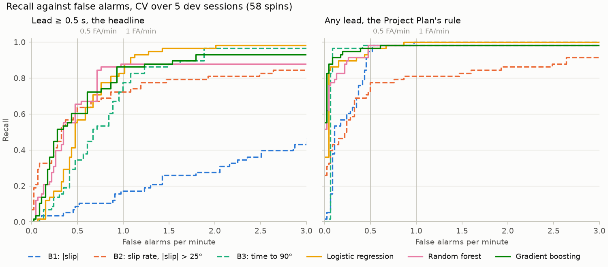
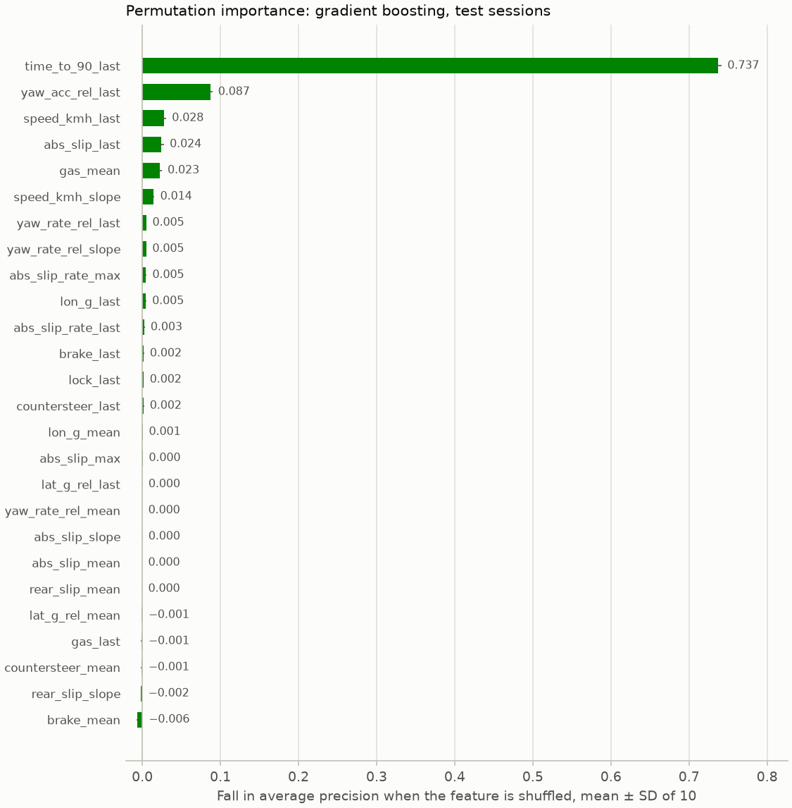

# spin-early-warning

Warns of a spin 0.5 s before it starts, from Assetto Corsa telemetry
recorded with [DriftScore](https://github.com/MihaiMike2005/DriftScoreUI)'s
logger, and compares the model with tuned physics baselines at the same
false-alarm rate. Work in progress: the plans are in `docs/`.

## Results

<!-- results:start -->
<!-- Written by `python -m spinwarn.report` from results/metrics.json: edits between the markers are overwritten. -->

From `results/metrics.json`: the final run of 2026-10-16 at the 0.5 s horizon, which scored the test sessions once. The test sessions hold 27 spins in 16.4 scored min: `2026-10-11_202102` (natural, 10 spins), `2026-10-14_233636` (deliberate, 17 spins). Each method's thresholds were set on CV, out of fold over 5 dev sessions (58 spins in 46.3 scored min), and each model was refit on all of them. Recall counts a spin caught with at least 0.5 s of lead (the headline) or with any lead from 0.1 s (the Project Plan's rule). Intervals are bootstrap 95%, the test spins resampled 1,000 times; one test spin is 3.7 points of recall.

### At the 1 FA/min threshold

Each method at its threshold for 1 false alarm a minute: the lowest that kept to it on CV. FA/min on test is the rate it gave on the test sessions.

| Method | Recall, lead ≥ 0.5 s | Recall, any lead | FA/min on test | Alert precision | Time in alarm | Median lead (s) |
| --- | --- | --- | --- | --- | --- | --- |
| B1: \|slip\| | 0.33 (9/27) [0.15, 0.52] | 1.00 (27/27) [1.00, 1.00] | 1.10 | 0.60 | 2.7% | 0.28 |
| B2: slip rate, \|slip\| > 25° | 0.59 (16/27) [0.41, 0.78] | 0.63 (17/27) [0.44, 0.78] | 0.67 | 0.61 | 1.3% | 0.67 |
| B3: time to 90° | 0.93 (25/27) [0.81, 1.00] | 1.00 (27/27) [1.00, 1.00] | 1.22 | 0.59 | 2.6% | 0.55 |
| Logistic regression | 0.89 (24/27) [0.78, 1.00] | 1.00 (27/27) [1.00, 1.00] | 0.98 | 0.63 | 2.9% | 0.65 |
| Random forest | 0.93 (25/27) [0.81, 1.00] | 1.00 (27/27) [1.00, 1.00] | 0.91 | 0.64 | 2.7% | 0.62 |
| Gradient boosting | 0.93 (25/27) [0.81, 1.00] | 1.00 (27/27) [1.00, 1.00] | 1.40 | 0.54 | 2.6% | 0.62 |

### At the 0.5 FA/min threshold

Each method at its threshold for 0.5 false alarms a minute: the lowest that kept to it on CV. FA/min on test is the rate it gave on the test sessions.

| Method | Recall, lead ≥ 0.5 s | Recall, any lead | FA/min on test | Alert precision | Time in alarm | Median lead (s) |
| --- | --- | --- | --- | --- | --- | --- |
| B1: \|slip\| | 0.19 (5/27) [0.04, 0.33] | 0.96 (26/27) [0.89, 1.00] | 0.67 | 0.71 | 1.6% | 0.23 |
| B2: slip rate, \|slip\| > 25° | 0.56 (15/27) [0.37, 0.74] | 0.59 (16/27) [0.41, 0.74] | 0.30 | 0.76 | 1.0% | 0.64 |
| B3: time to 90° | 0.19 (5/27) [0.04, 0.33] | 1.00 (27/27) [1.00, 1.00] | 0.85 | 0.67 | 1.7% | 0.40 |
| Logistic regression | 0.74 (20/27) [0.59, 0.89] | 1.00 (27/27) [1.00, 1.00] | 0.79 | 0.68 | 2.3% | 0.53 |
| Random forest | 0.78 (21/27) [0.63, 0.93] | 1.00 (27/27) [1.00, 1.00] | 0.79 | 0.68 | 2.0% | 0.57 |
| Gradient boosting | 0.78 (21/27) [0.59, 0.93] | 1.00 (27/27) [1.00, 1.00] | 0.61 | 0.74 | 2.0% | 0.55 |

### Natural and deliberate spins

The headline per kind. FA/min is the rate in that kind's test sessions. A kind with under 10 spins says so.

| Method | Spins | @ 1 FA/min: recall, lead ≥ 0.5 s | FA/min | @ 0.5 FA/min: recall, lead ≥ 0.5 s | FA/min |
| --- | --- | --- | --- | --- | --- |
| B1: \|slip\| | deliberate (17) | 0.35 (6/17) [0.12, 0.59] | 0.91 | 0.18 (3/17) [0.00, 0.35] | 0.65 |
|  | natural (10) | 0.30 (3/10) [0.00, 0.60] | 1.26 | 0.20 (2/10) [0.00, 0.50] | 0.69 |
| B2: slip rate, \|slip\| > 25° | deliberate (17) | 0.65 (11/17) [0.41, 0.88] | 0.91 | 0.65 (11/17) [0.41, 0.88] | 0.52 |
|  | natural (10) | 0.50 (5/10) [0.20, 0.80] | 0.46 | 0.40 (4/10) [0.10, 0.70] | 0.11 |
| B3: time to 90° | deliberate (17) | 0.94 (16/17) [0.82, 1.00] | 1.30 | 0.18 (3/17) [0.00, 0.35] | 0.91 |
|  | natural (10) | 0.90 (9/10) [0.70, 1.00] | 1.15 | 0.20 (2/10) [0.00, 0.50] | 0.80 |
| Logistic regression | deliberate (17) | 0.94 (16/17) [0.82, 1.00] | 1.04 | 0.82 (14/17) [0.65, 1.00] | 1.04 |
|  | natural (10) | 0.80 (8/10) [0.50, 1.00] | 0.92 | 0.60 (6/10) [0.30, 0.90] | 0.57 |
| Random forest | deliberate (17) | 1.00 (17/17) [1.00, 1.00] | 1.04 | 0.82 (14/17) [0.65, 1.00] | 0.91 |
|  | natural (10) | 0.80 (8/10) [0.50, 1.00] | 0.80 | 0.70 (7/10) [0.40, 1.00] | 0.69 |
| Gradient boosting | deliberate (17) | 1.00 (17/17) [1.00, 1.00] | 1.17 | 0.82 (14/17) [0.65, 1.00] | 0.91 |
|  | natural (10) | 0.80 (8/10) [0.50, 1.00] | 1.61 | 0.70 (7/10) [0.40, 0.90] | 0.34 |

### Each model against B3 and B2, spin by spin

On the same 27 test spins, by the headline: the spins one catches with at least 0.5 s of lead and the other doesn't, and the difference in recall with a paired bootstrap 95% interval (both methods on the same 1,000 resamples of the spins). Each method runs at its own threshold from CV, so at its own false-alarm rate on test, as in the tables above.

| Model | Against | @ 1 FA/min: model only / baseline only | Difference in recall | @ 0.5 FA/min: model only / baseline only | Difference in recall |
| --- | --- | --- | --- | --- | --- |
| Logistic regression | B3: time to 90° | 2 / 3 | −0.04 [−0.19, 0.11] | 16 / 1 | +0.56 [0.33, 0.74] |
| Random forest | B3: time to 90° | 2 / 2 | +0.00 [−0.15, 0.15] | 16 / 0 | +0.59 [0.41, 0.78] |
| Gradient boosting | B3: time to 90° | 2 / 2 | +0.00 [−0.15, 0.15] | 17 / 1 | +0.59 [0.37, 0.81] |
| Logistic regression | B2: slip rate, \|slip\| > 25° | 9 / 1 | +0.30 [0.11, 0.48] | 6 / 1 | +0.19 [0.04, 0.37] |
| Random forest | B2: slip rate, \|slip\| > 25° | 9 / 0 | +0.33 [0.15, 0.52] | 8 / 2 | +0.22 [0.00, 0.44] |
| Gradient boosting | B2: slip rate, \|slip\| > 25° | 9 / 0 | +0.33 [0.15, 0.52] | 8 / 2 | +0.22 [0.00, 0.44] |

### Configs, PR-AUC and time per prediction

PR-AUC is average precision on the scored frames: out of fold on CV, and the refit model on test. Time per prediction is the median of single-row predictions on scored test frames, timed by the final run.

| Method | Params | Chosen by | PR-AUC, CV → test | ms per prediction |
| --- | --- | --- | --- | --- |
| B1: \|slip\| | — | nothing to tune | 0.440 → 0.410 | 0.00512 |
| B2: slip rate, \|slip\| > 25° | `{"theta1": 25}` | θ1 best of 10–80° by recall @ 1 FA/min, lead ≥ 0.5 s | 0.535 → 0.485 | 0.0112 |
| B3: time to 90° | — | nothing to tune | 0.838 → 0.778 | 0.00538 |
| Logistic regression | `{"C": 0.01}` | PR-AUC, best of 4 configs | 0.873 → 0.835 | 0.0752 |
| Random forest | `{"n_estimators": 200, "min_samples_leaf": 20, "max_features": 0.5, "max_depth": null}` | PR-AUC, best of 15 configs | 0.865 → 0.939 | 13.2 (3.35 on one core) |
| Gradient boosting | `{"min_samples_leaf": 50, "max_leaf_nodes": 15, "learning_rate": 0.1, "l2_regularization": 1}` | PR-AUC, best of 15 configs | 0.904 → 0.933 | 1.53 |

### Recall against false alarms, on CV



Out of fold over the 5 dev sessions (58 spins). At each false-alarm rate, the recall of the threshold `threshold_for_fa` sets for that rate, as it set the final run's for each target (the vertical lines): the lowest within the rate, from the threshold with the most false alarms up. Below that one, alarms run together into fewer and longer alerts, down to the alarm left on, which catches every spin; no threshold is set there. The test sessions have no curve: `metrics.json` keeps them only at the two thresholds.

### Permutation importance



Gradient boosting, the models' best CV PR-AUC, on the scored test frames: how far average precision falls when one feature is shuffled, mean ± SD over 10 shuffles. Features that carry the same information share it, so a short bar doesn't mean the information is unused.
<!-- results:end -->

## Limitations

- **Simulated data, one driver, one car.** Every session is Assetto Corsa
  physics, driven by one person in one car, the S14
  (`hush_nissan_silvia_s14`), on one track, Sepang (`rmi_gpk_sepang`), with
  TC off. Nothing here shows how it carries over to a real car, another
  driver, or another car or track.
- **A small test set.** 85 spins over 7 sessions, short of the Project
  Plan's 100+ over about 10: 58 spins in the 5 dev sessions and 27 in the 2
  test sessions. One test spin is 3.7 points of recall, so the intervals
  are wide and small gaps between methods mean little.
- **Deliberate against natural spins.** In a deliberate session the driver
  was trying to spin; in a natural one, holding drifts at the limit, so its
  spins are failed saves. They can look different, and 39 of the 58 dev
  spins are deliberate. Recall is reported for each kind, and at the 1
  FA/min threshold every method catches a larger share of the deliberate
  spins.
- **The natural test session has exactly 10 spins,** so one natural spin is
  10 points of recall.
- **`2026-10-11_202102` isn't fully unseen.** Step 9 of the Build Plan (in
  `docs/`) weighed the features partly by their correlation with the target
  on all three Oct 11 sessions, `202102` among them, before it was locked as
  a test session. Oct 14's natural sessions had too few spins to test on (1
  and 4), so the natural test session had to come from Oct 11.
- **The CV thresholds didn't hold their false-alarm rate on test.** Each
  method's thresholds were set on CV for 1 and 0.5 false alarms a minute. On
  the test sessions, the 1 FA/min thresholds gave 0.67–1.40 FA/min, and the
  0.5 thresholds 0.30–0.85. So the methods are compared at the same target,
  not at the same rate on test, and each recall above comes with its own
  rate. B1 and B3 have nothing to refit and overshoot too, so it's at least
  partly the sessions.
- **Label edge cases.** The label rule's spot-check is 20/20 on video, but
  two of the hits are borderline: `2026-10-11_200553` spin 12 goes past
  180° and ends in a wall 1.1 s after its onset, and `2026-10-11_194646`
  spin 14 peaks at 95° and is driven out of. Counted as misses, the
  spot-check would be 18/20.

## Setup

Python 3.14, since spinwarn installs driftscore, which requires it. From the
repo root:

```
python3.14 -m venv .venv
source .venv/bin/activate
pip install -e '.[dev]'
```

That pulls driftscore from GitHub, as CI does, and it's all spinwarn needs.

Optional, only for working on DriftScore alongside this repo: with a
DriftScore checkout next to it, in `../AssetoCorsa Drift Score`,

```
pip install -e "../AssetoCorsa Drift Score"
```

swaps the GitHub driftscore for that checkout, so edits there show up here.
Keep that order: `pip install -e '.[dev]'` replaces a local driftscore with
the GitHub one, so after rerunning it, rerun this too.

To reproduce the results with the exact versions that made them, install
from `requirements.txt` instead. It's the `pip freeze` of that venv
(Python 3.14.5 on macOS), with driftscore pinned to the DriftScoreUI commit
it ran, and spinwarn itself left out, so it goes in on its own:

```
python3.14 -m venv .venv
source .venv/bin/activate
pip install -r requirements.txt
pip install -e . --no-deps
```

## Test

```
pytest
```

## Data

Raw recordings go in `data/raw/`, which git ignores: the logger's CSV and
JSON for each session, copied from the AC PC. `notes.md` is the session log.
The screen recordings stay outside the repo.

```
python -m spinwarn.data [--rebuild]
```

resamples every dev session onto the 60 Hz grid, adds the derived signals
and caches it in `data/processed/`. Each cached session remembers the
constants that built it and is rebuilt when `config.py` changes them.
`--rebuild` forces it, for what the cache can't see: a change to the code,
or a raw CSV copied over again.

```
python -m spinwarn.labeling
```

prints how many spins the label rule finds in each dev session.

```
python -m spinwarn.spotcheck <session> --n 20 --video-offset 3.2
```

lists seeded-random spin onsets of a dev session as times in its screen
recording, each with its peak |slip| and speed, as a table to paste into
`notes.md` and mark hit or miss on video. The offset is the video time at
which the logger's status line shows t = 0.

`notebooks/01_explore.ipynb` shows each dev session: the raw rate and gaps,
slip angle with the onsets marked, zooms on three onsets, where the drifts
sit relative to 90°, the countersteer sign check behind `COUNTERSTEER_SIGN`,
and every spin with the spot-check commands.

```
python -m spinwarn.run build
```

labels every dev session, computes its features and writes them into one
table, `data/processed/dataset.parquet`, one row per grid frame, then prints
minutes, spins and positive frames per session. Nothing models on it until
the test sessions are locked. A table built from other sessions or other
constants is refused, so build again after copying in a session, locking
the test sessions or changing `config.py`. It can't see a change to the
code, so build again after `python -m spinwarn.data --rebuild` too.

```
python -m spinwarn.run lock-test --sessions A,B
```

sets the test sessions aside in `data/splits.json`, once, before any
modelling: pick 2 with typical spin counts from build's output, commit the
file, and build again. It refuses if the file exists, or if fewer than
`N_FOLDS` sessions would be left for cross-validation.

```
python -m spinwarn.run build --horizon 1.0
```

labels the same table at another horizon, for the secondary run, into a
file of its own beside the main one: `dataset_h1.parquet` for 1.0 s. It
remembers its horizon, and is refused and rebuilt like the main one.

```
python -m spinwarn.run cv --method b1|b2|b3|lr|rf|hgb [--params '{...}'] [--horizon 0.5] [--note "..."]
```

scores every dev frame with a method that never saw its session (4-fold
CV, grouped by session) and prints PR-AUC, plus, at 1 and 0.5 false alarms
a minute: recall, alert precision, time in alarm and median lead. It saves
the scores to `results/cv/<run>.parquet` and appends a row to
`experiments.md`. B2 without `--params` first picks its |slip| gate θ1
from 10–80° by the headline below; `--params '{"theta1": 50}'` fixes it.
`--horizon 1.0` reads the table `build --horizon 1.0` wrote.

The models are logistic regression (`lr`), random forest (`rf`) and
gradient boosting (`hgb`), class-weighted for the rare spins and seeded.
Each fold's model fits on the other folds' scored frames, thinned to
20 Hz, and reads every feature. Logistic regression reads rear wheel slip
through a signed log, since it spikes to 1e5 and more, which would swamp
its scaling. `--params '{"C": 0.1}'` sets a model's params; without them
it takes scikit-learn's defaults.

```
python -m spinwarn.run tune --method b1|b2|b3|lr|rf|hgb [--n 15] [--horizon 0.5] [--note "..."]
```

makes each method's CV run for the final test and records it in
`results/chosen.json`. A model tries `--n` configs sampled from its grid
with a fixed seed, each one `cv` run, saved and logged as `cv` does, and
keeps the best by PR-AUC. A baseline runs once: b1 and b3 have nothing to
tune, and b2 picks θ1 by the headline, as `cv` does. `--horizon 1.0` reads
that horizon's table and records into `results/chosen_h1.json`.

```
python -m spinwarn.run final [--horizon 1.0] [--force] [--note "..."]
```

scores the test sessions once, with every method's run in
`results/chosen.json`. It checks each run against the dataset first. Each
method's thresholds at 1 and 0.5 FA/min come from its run's out-of-fold
scores, and each model is refit on every dev session. Only then does it
load the test sessions, label them with today's rule and score them. It
reports both recalls with bootstrap 95% intervals (the test spins
resampled 1,000 times), the same for natural and deliberate spins, plus
PR-AUC, time in alarm, median lead and the median time of one single-row
prediction. It also runs permutation importance on the test sessions for
the model with the best CV PR-AUC. Everything goes to
`results/metrics.json`, with `null` where a number is undefined (a missed
spin's lead, a ratio with nothing to divide by). `results/final.lock` is
written just before the test sessions load, and `final` refuses to run
while it or `metrics.json` exists. `--force` overrides them and logs the
rerun in `experiments.md`.
`--horizon 1.0` reads `results/chosen_h1.json` and writes
`metrics_h1.json`, with its own lock.

```
python -m spinwarn.report
```

reads `results/metrics.json` and writes `results/results_table.md`,
`results/recall_vs_fa.png`, `results/importance.png` and the Results
section above, between its markers, leaving the rest of the README as it
is. It reads nothing else, so it runs on a fresh clone without the raw
recordings.

The headline is recall at 1 FA/min counting only spins warned of at least
0.5 s ahead, the horizon the labels look. Recall by the Project Plan's
rule, which counts any warning 0.1 s or more ahead, comes beside it. That
rule alone can't separate methods: a spin is |slip| crossing 90°, and
0.1 s before it every spin is already over 71.8°, so B1, a threshold on
|slip| at 71.4°, catches all 58 on CV.

Alert precision doesn't compare methods either. Nearly every spin a
method alerts on gets exactly one alert that isn't false, so at a given
false-alarm target alert precision is about spins alerted on ÷ (that +
false alarms). Recall and the target already say that. At 0.5 FA/min on
CV, B1 and B3 both come out at exactly 0.725: 58 alerts that aren't false
and 22 false.

## Reproduce

From a fresh clone, `pytest` and `python -m spinwarn.report` need nothing
but the repo. `report` only rewrites the tables, the plots and the Results
section from the committed `results/metrics.json`, so it gives the same
README whatever else has run. It checks the report, not the numbers.

To make the numbers again, the pipeline needs the raw recordings, which git
doesn't hold: put each session's CSV and JSON in `data/raw/`. Then, after
the setup above:

```
python -m spinwarn.run build
python -m spinwarn.run tune --method b1
python -m spinwarn.run tune --method b2
python -m spinwarn.run tune --method b3
python -m spinwarn.run tune --method lr
python -m spinwarn.run tune --method rf
python -m spinwarn.run tune --method hgb
python -m spinwarn.run final --force --note "reproduce"
python -m spinwarn.report
```

`build` labels the dev sessions and computes their features; the test
sessions stay locked in `data/splits.json`. Each `tune` is seeded, so it
makes its method's CV run again in `results/cv/` and should choose the same
params with the same PR-AUC. It rewrites `results/chosen.json` with the new
runs' ids, though, and appends every run to `experiments.md`, as each
tuning did.

`final` scored the test sessions once, on 2026-10-16, and refuses to run
again while `results/final.lock` or `results/metrics.json` is there, so
scoring them again takes `--force`. That rewrites both files, logs a row
in `experiments.md`, and makes the Results say the run was forced. Then
`git diff results/metrics.json` shows what came out differently. Expect
the run's start time, `"forced": true` and the times per prediction to
change, and every other number to stay the same.

Everything these commands rewrite is tracked, so to go back to the
committed results afterwards:

```
git checkout -- README.md experiments.md results/
```

## Layout

| Path | What it is |
| --- | --- |
| `docs/` | The Project Plan and the Build Plan |
| `data/raw/` | Logger CSV + JSON per session (gitignored) |
| `data/processed/` | Sessions on the 60 Hz grid with derived signals, and the datasets (gitignored) |
| `data/sample/` | One short recording, committed: `2026-10-11_191720`, the logger's 3-minute live check on Brooklyn Park, not in the dataset |
| `data/splits.json` | The locked test sessions (committed) |
| `src/spinwarn/config.py` | Every constant, in seconds |
| `src/spinwarn/` | The pipeline: load, label, features, models, evaluation |
| `notebooks/01_explore.ipynb` | Rate and gaps, slip with onsets, the countersteer sign, every spin |
| `results/cv/` | Out-of-fold scores, one file per CV run (gitignored) |
| `results/chosen.json` | Each method's tuned CV run, for the final test |
| `results/metrics.json` | The final test's results, and `results/final.lock`, its run-once lock |
| `results/results_table.md`, `results/*.png` | The results tables and plots, written by `report` |
| `requirements.txt` | The exact versions the results were made with |
| `notes.md` | Session log: car, track, setup, minutes, spins, kind, video |
| `experiments.md` | One row per CV run |
